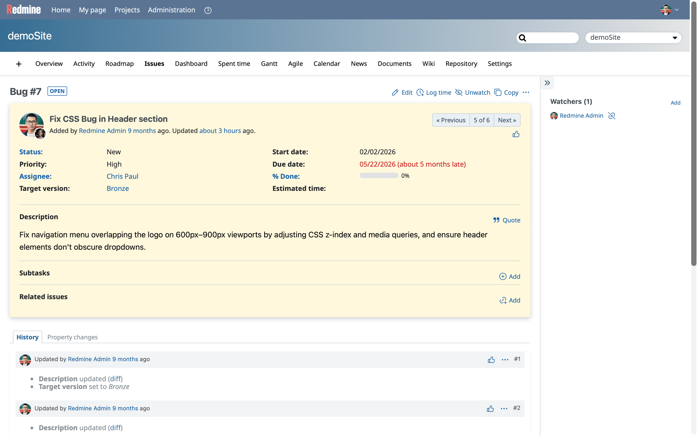
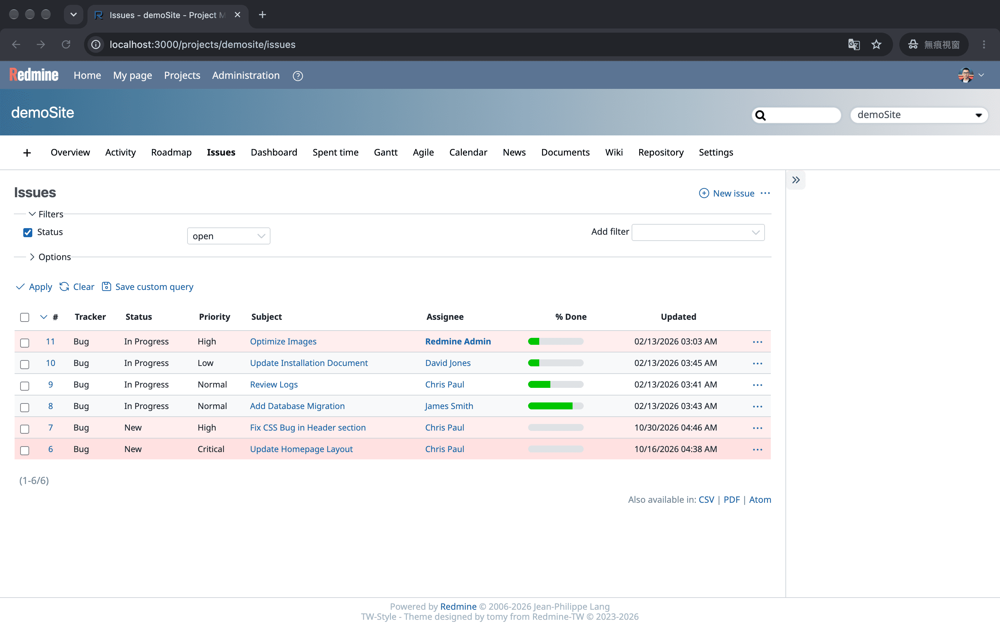
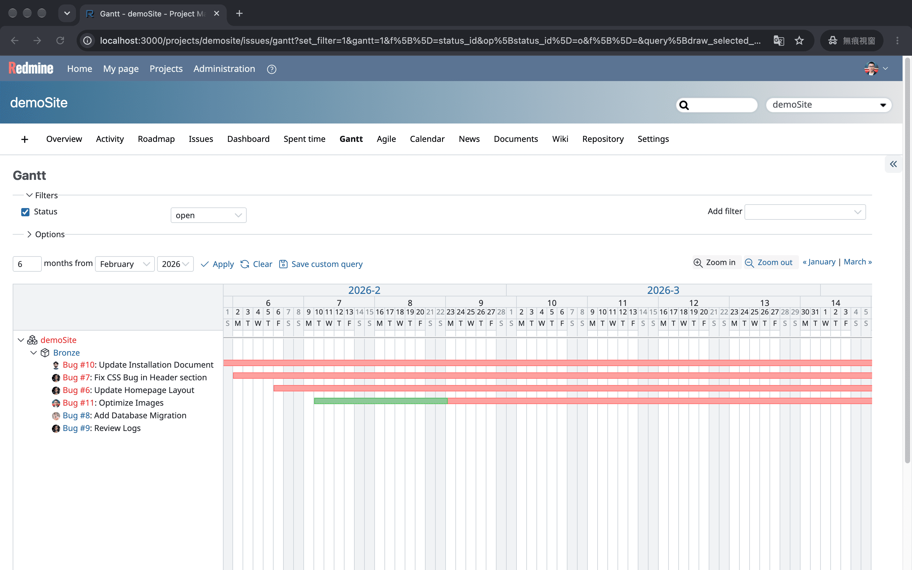

# TW-Style

A free Redmine theme made in Taiwan.

With simple design, create a style that is compatible with English and Chinese visuals. This is my first time working on Github. If you like this, please feel free to give a star to this project.

**Version：** 4.0.0

**Compatible with :** Redmine 7.x only

**Supported by :** [Redmine-TW](https://redmine-tw.net)

> 3.0.0 version is compatible with Redmine 6.X

> 2.2.0 and previous versions are compatible with Redmine 5.1 - 4.1

## Installation

To install TW-Style, just download .zip and unpack it to your Redmine's themes/ folder.
Then go to Redmine > Administration > Settings > Display and select TW-Style from the list and save the changes.

> After installing or updating the theme, precompile assets and restart the Redmine web service.

## Issues are listed in different colors according to their priority

Issue priorities can be added from the enumerations in the administration, and the weight is determined according to the sort order. By default, the lowest weight and the top three with the highest weight will be displayed in different color.

## How to replace Logo for your Redmine

1. Find 'Website LOGO' in the application.css
2. Change the file name if you upload new image
3. If your image file size is too large or too small, You may also need to adjust css parameters

## Screenshots

## Contributing

1. Fork it
2. Create your feature branch (git checkout -b my-new-feature)
3. Commit your changes (git commit -am 'Add some feature')
4. Push to the branch (git push origin my-new-feature)
5. Create new Pull Request

## License

+ MIT

See License file to read detail.
